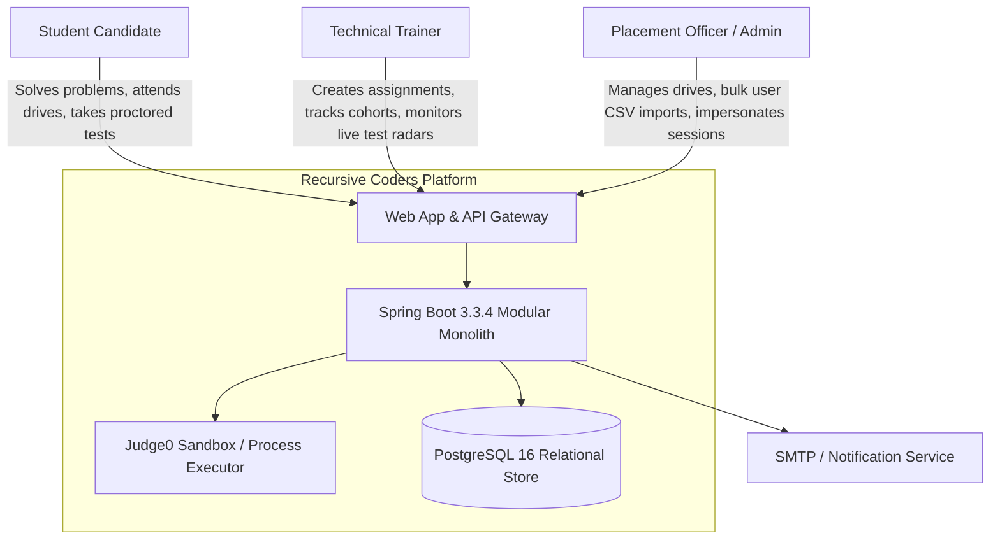
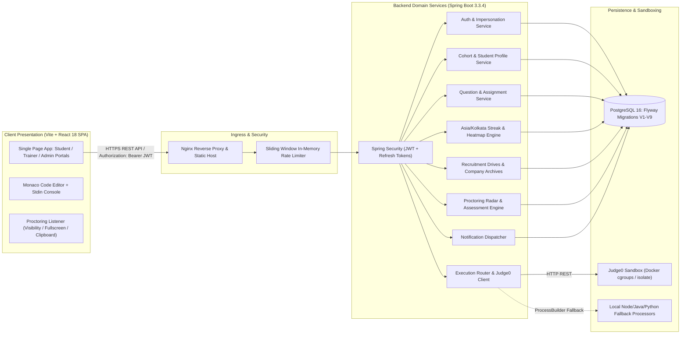
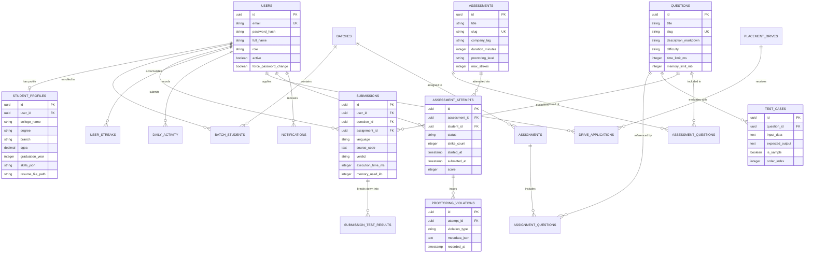
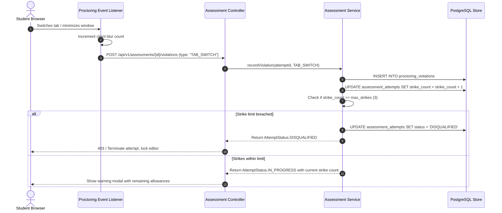

# System Design Specification: Recursive Coders Platform

## 1. Executive Summary & System Scope

The Recursive Coders Platform is an enterprise-grade, multi-tenant training and placement lifecycle management system tailored for technical academies, universities, and enterprise hiring pipelines. It provides an end-to-end workflow spanning candidate onboarding, cohort management, automated code assessment across 4 major runtime languages (Python 3.10, Java 21 OpenJDK, JavaScript Node.js 20, and C++ GCC 13), anti-cheat proctored examination arenas, placement recruitment pipelines, and historical company interview question archives.

### Primary Objectives
- **Zero-Trust Code Sandbox**: Sandboxed execution of student code with strict memory, CPU, and network boundaries preventing arbitrary host execution.
- **Strict Role Isolation**: Discrete data segregation between Student, Trainer, and Placement Administrator personas with audit-logged administrative impersonation.
- **Academic Integrity Verification**: Real-time browser telemetry, blur/visibility monitoring, paste traps, and automated strike threshold disqualification during timed assessments.
- **Interview Readiness & Retrospective Analytics**: Structured previous question archives organized by recruiting companies, compensation tiers, and rounds, linked directly to interactive practice environments.

---

## 2. High-Level Architecture (C4 Model)

### 2.1 Level 1: System Context
The platform interfaces with three human actor roles and two infrastructure boundary providers.



### 2.2 Level 2: Container Architecture
The platform is packaged into decoupled, horizontally scalable containers orchestrated via Docker Compose or Kubernetes.



---

## 3. Modular Monolith Architecture

To balance development velocity, transactional integrity, and operational simplicity, the backend is organized as a package-by-feature modular monolith. Each module encapsulates its JPA entities, repositories, service contracts, implementations, and REST controllers.

```
com.company.placement/
├── common/             # Global error handler, ApiResponse wrapper, audit base entity, rate limiter
├── auth/               # JWT token provider, authentication filter, login/refresh/change-pass endpoints
├── user/               # User account entity, Role enum, Admin user provisioning, CSV bulk parser
├── batch/              # Cohort entity, trainer assignment, student enrollment lifecycle
├── student/            # Academic profiles, CGPA, graduation years, skills, resume storage
├── question/           # Problem statements, Markdown rendering, sample and hidden test case suites
├── assignment/         # Cohort assignments, deadline rules, question points
├── execution/          # ProgrammingLanguage enum, Judge0 client, native fallback execution runner
├── submission/         # Source code submissions, per-test case verdicts, runtime metrics
├── scoring/            # Asia/Kolkata timezone calendar calculations, activity heatmap, leaderboard
├── placement/          # Corporate recruitment drives, eligibility rules, 4-stage application pipeline
├── company/            # Company previous questions archive, interview patterns, compensation tiers
├── assessment/         # Timed mock recruitment tests, proctoring violation auditor, radar roster
├── notification/       # In-app notifications, broadcast triggers, unread state management
└── analytics/          # Cohort performance metrics, weak topics radar, pass rates
```

---

## 4. Database Schema & Data Models

The relational schema is managed using Flyway versioned migrations (`V1__baseline.sql` through `V9__proctoring_and_assessments.sql`). All entities extend `BaseEntity`, inheriting UUID primary keys, UTC audit timestamps, and optimistic locking `@Version` increments.



---

## 5. Core Subsystem Deep-Dive

### 5.1 Isolated Multi-Language Code Execution Engine

The execution subsystem handles code testing in Python, Java 21, JavaScript, and C++.

1. **Language Specification & IDs**:
   - Python 3.10: Judge0 language ID `71`
   - Java 21 OpenJDK: Judge0 language ID `91` (fallback `62`)
   - JavaScript Node.js 20: Judge0 language ID `63`
   - C++ GCC 13: Judge0 language ID `54`
2. **Two-Tiered Execution Dispatcher**:
   - **Primary**: Distributed Judge0 microservice via Docker sandbox with `isolate` memory capping, non-root execution, and network isolation.
   - **Fallback**: Local host sub-process executor (`ProcessBuilder`) with time limits, strictly invoked if Judge0 is unreachable in offline development mode.
3. **Template Neutrality**: Starter code provided in assessment and practice editors provides language-compliant signatures without revealing algorithms or solutions, ensuring true evaluation of candidate ability.

### 5.2 Anti-Cheat & Proctoring Engine

During timed mock assessments, academic integrity is enforced through synchronized client telemetry and server-side strike accumulation.



### 5.3 Asia/Kolkata Activity & Streak Engine

Streak calculation operates against the candidate's canonical timezone (`Asia/Kolkata` / UTC+05:30) rather than server UTC:
- Submissions are transformed to local calendar dates (`LocalDate.now(ZoneId.of("Asia/Kolkata"))`).
- When a submission achieves an `ACCEPTED` verdict, `DailyActivity` is upserted for that calendar date.
- `UserStreak` calculates continuous consecutive active days:
  - If last active date was today: streak remains unchanged.
  - If last active date was yesterday: streak increments by 1.
  - If last active date was more than 1 day ago: streak resets to 1.
  - Longest streak ever achieved is persisted monotonically.

### 5.4 Company Previous Questions Archive

To prepare candidates for specific campus recruiters, the system provides a specialized interview preparation archive:
- **Taxonomy**: Filterable by Company (Amazon, Google, Microsoft, TCS Digital, Infosys), Interview Round (Online Assessment, Technical Round 1, Technical Round 2), Difficulty, and Compensation Tier.
- **Content Delivery**: Provides problem statements, input/output constraints, candidate strategy pointers, and direct shortcuts to initialize live IDE sessions with blank starters.

---

## 6. Security Architecture & Threat Mitigation

| Threat Vector | Mitigation Strategy | Implementation |
| :--- | :--- | :--- |
| **Sandbox Escape / Host Compromise** | Container isolation, read-only root filesystems, unprivileged users | Judge0 isolate runner with 256MB RAM / 2.0s CPU cap |
| **Denial of Service / Brute Force** | IP-based sliding window rate limiting | `RateLimiterService` (100 req/min general, 10 req/min for auth/execute) |
| **Privilege Escalation** | Pre-authorized method security and role verification | `@PreAuthorize("hasRole('ADMIN')")`, JWT claim parsing |
| **Cross-Site Scripting (XSS)** | Sanitized Markdown rendering and CSP headers | DOMPurify on frontend, OWASP `Content-Security-Policy` header |
| **Token Theft / Replay** | Short-lived access tokens with rotating refresh tokens | 15-minute access token, single-use refresh token with database invalidation |
| **Unauthorized Impersonation** | Restrictive impersonation endpoint with audit logging | Admin-only impersonation filter logging original administrator subject |

---

## 7. Performance & Scalability Considerations

1. **Stateless App Tier**: The Spring Boot backend stores no session state on the host; horizontal autoscaling can be achieved behind Nginx or AWS ALB.
2. **Database Indexing**:
   - Unique index on `users(email)`.
   - Composite index on `submissions(user_id, question_id, created_at DESC)`.
   - Index on `assessment_attempts(assessment_id, student_id)`.
   - Index on `daily_activity(user_id, activity_date)`.
3. **Frontend Bundle Optimization**:
   - Route-based code splitting via `React.lazy()` for Admin, Trainer, and Assessment Arena bundles.
   - Monaco Editor loaded via on-demand CDN chunks.
   - SVG icon tree-shaking with `lucide-react`.

---

## 8. Verification & Operational Metrics

- **Unit & Integration Test Suite**: 46 backend Spring Boot tests validating JWT lifecycle, assessment proctoring, submission verdicts, and streak logic.
- **Production Build Artifacts**:
  - Docker multi-stage images producing minimal Alpine/Debian slim runtimes.
  - Health check probes at `/api/v1/health` verifying database connectivity and disk capacity.
